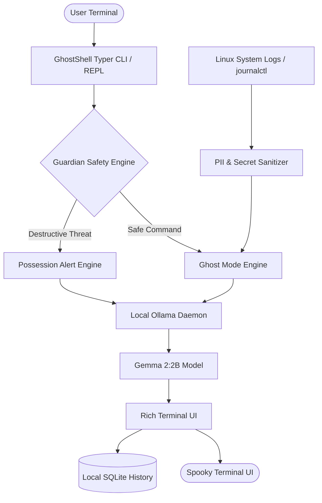

*This article is a submission for the [Hacktoberfest 2026 DEV Challenge: Ghost in the Machine](https://dev.to).*

---

```
        .-.
       (o.o)     👻 GHOSTSHELL 👻
        |=|      The Spooky, AI-Powered Linux Terminal Companion
       __|__     100% Offline • Local Gemma 2 • Zero Cloud Hops
     //.=|=.\\
    // .=|=. \\
    \\ .=|=. //  "Fear not, mortal, for I am Specter...
     \\(_=_)//    trapped in your terminal since the UNIX Epoch."
```

## 🔮 What We Built

Linux terminals can be intimidating—and sometimes perilous. A single misplaced space in `rm -rf /` or an accidental block overwrite via `dd` can turn an afternoon of development into a digital horror story.

For the **Ghost in the Machine** challenge, we built **[GhostShell](https://github.com/GSuryaP/GhostShell)**: a spooky, AI-powered Linux terminal companion that haunts your Ubuntu terminal. 

GhostShell acts as a wise, ancient digital specter named **Specter** who has resided in POSIX systems since the UNIX Epoch (Jan 1, 1970). It explains cryptic bash commands, catches demonic (destructive) commands before they execute, and turns raw, cryptic Linux system logs into gothic tales of paranormal activity—all powered by **Gemma 2 (2B)** running **100% offline via Ollama**.

---

## 🌟 Key Features

### 1. 👻 Ghost Mode: Deciphering the Arcane
Cryptic commands like `tar -czvf archive.tar.gz /var/log` are parsed and explained through atmospheric gothic metaphors without losing technical rigor. The model explains each flag (`-c` for creation, `-z` for gzip compression soul, `-v` for the verbose spectral echo) and what happens inside the OS kernel.

```bash
ghostshell ghost "tar -czvf backup.tar.gz /var/log"
```

### 2. ⚠️ Possession Alerts: The Layered Guardian
If a user or a rogue script attempts a catastrophic command (like `rm -rf / --no-preserve-root`, a fork bomb `:(){ :|:& };:`, or raw disk writing `dd of=/dev/sda`), GhostShell’s **Guardian Engine** immediately intervenes.
* **Layer 1 (Zero-Latency Deterministic AST/Regex):** Evaluated in under 1 millisecond. No waiting for LLM tokens before safety kicks in.
* **Layer 2 (Spectral Risk Warning & Safe Exorcism):** Gemma 2 explains the catastrophe and provides an *exorcised, safe alternative* (like `trash-put` or dry-run flags).

### 3. 📜 Haunted Logs: Turning journalctl into Gothic Chronicles
System errors shouldn't be boring strings of cryptic hex codes. GhostShell inspects `journalctl -p err..emerg` or `/var/log/syslog`, scrubs private data (IPs, MAC addresses, credentials), and weaves an eerie mystery story:
* A GPU power-suspend failure becomes an account of a frozen graphics processor refusing to sleep.
* A failed SSH attempt becomes phantom knocks at port 22.
* Memory pressure becomes the howling chill of the OOM-killer reaper.

### 4. 🔮 Ask the Ghost & Interactive REPL
Mortals can consult the ghost interactively via `ghostshell ask "<question>"` or enter the standalone `ghostshell interactive` shell powered by `prompt-toolkit` and `Rich`.

### 5. 🌐 Modern Glassmorphic Web Dashboard (`ghostshell web`)
For developers who prefer a visual interface, GhostShell includes a dark-mode web dashboard featuring interactive command preset chips, real-time risk gauges, live telemetry timeline tables, and streaming AI responses.

---

## 🛡️ Safety & Non-Invasive Philosophy

A common fear with AI shell utilities is that they hook into `.bashrc`, replace Bash, or run autonomous commands with elevated privileges. 

**GhostShell guarantees zero shell invasion:**
* It is a **standalone CLI application**.
* It **never replaces Bash or modifies shell configurations**.
* It **never automatically executes commands**. It solely audits, explains, and advises.
* You can develop and run it in an isolated Python virtual environment without changing your terminal setup.

---

## ⚙️ Architecture & Tech Stack



* **AI Model:** Gemma 2 (2B) running locally via [Ollama](https://ollama.com).
* **Terminal UI:** [Rich](https://github.com/Textualize/rich) for spectral green and eerie purple color palettes, glowing borders, live token streaming, and markdown panels.
* **Interactive Shell:** [Prompt-Toolkit](https://github.com/prompt-toolkit/python-prompt-toolkit) for custom prompts (`👻 ghost@crypt ❯`) and history.
* **Local Storage:** SQLite (`~/.ghostshell/history.db`) for tracking audited commands, risk levels, and chat history.
* **Automated Testing:** Pytest suite with 39 tests passing in **0.03s**.

---

## 🚀 The Advantage of 100% Offline AI

Why run a local open-weight model instead of a cloud API?

1. **Terminal Privacy is Absolute:** Terminal output frequently contains sensitive environment variables, tokens, internal hostnames, and IP addresses. By running Gemma 2 locally through Ollama, **zero bytes of terminal telemetry ever leave your machine**.
2. **Deterministic Pre-Filtering:** As discussed extensively in developer community security patterns, an LLM alone should never be the sole line of defense. GhostShell pairs instant deterministic pattern matching with local LLM reasoning to ensure zero-latency safety.
3. **No Latency / No Cloud Costs:** Instant offline execution during flights, train rides, or air-gapped server maintenance.

---

## 💻 Try it Yourself

```bash
# 1. Clone & Set Up
git clone https://github.com/GSuryaP/GhostShell.git
cd GhostShell
python3 -m venv .venv && source .venv/bin/activate
pip install -e .

# 2. Run the Automated Demo
ghostshell demo

# 3. Enter the Crypt
ghostshell interactive
```

---

## 🎃 Conclusion

GhostShell combines playful Halloween-themed storytelling with genuine Linux terminal utility and defensive developer guardrails. Open-weight models like Gemma 2 make it possible to run intelligent, private, and delightful assistants right on developer laptops without cloud dependency.

Check out the code, contribute, or drop an issue on GitHub! 

Happy Hacktoberfest! 👻🍂
