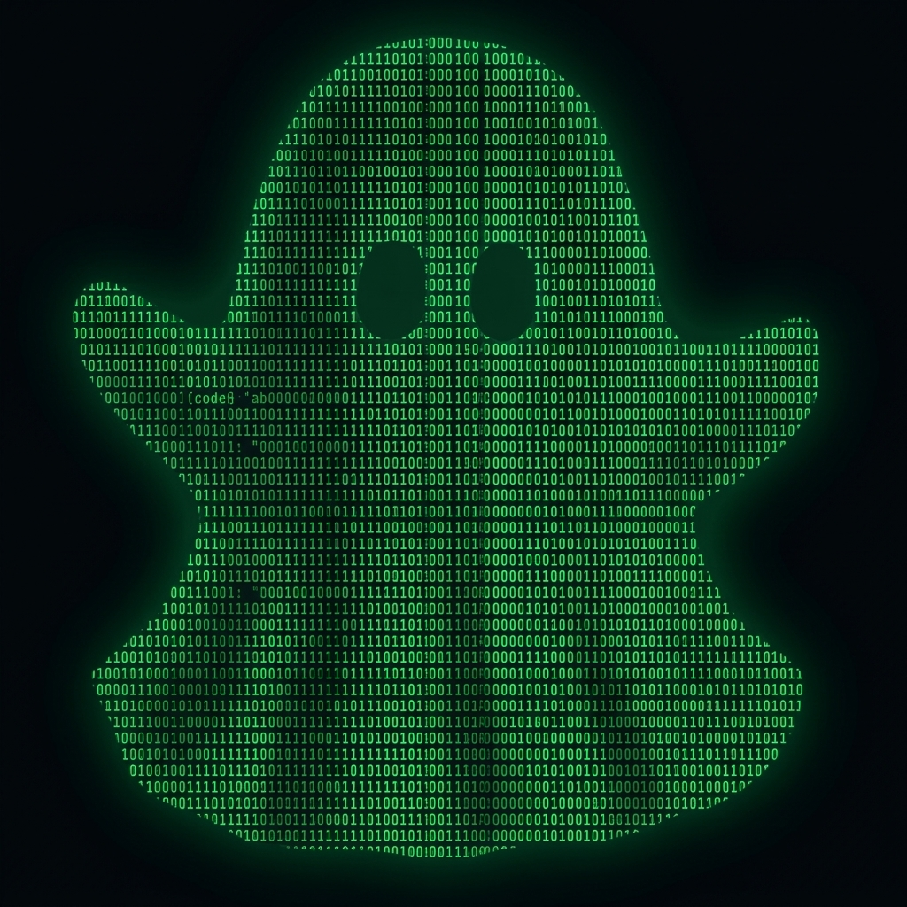
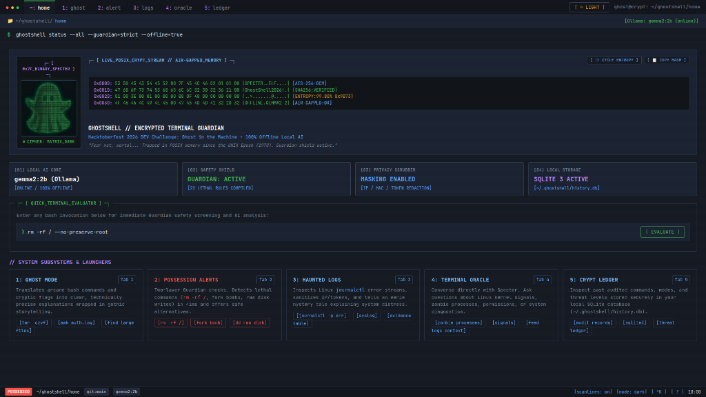
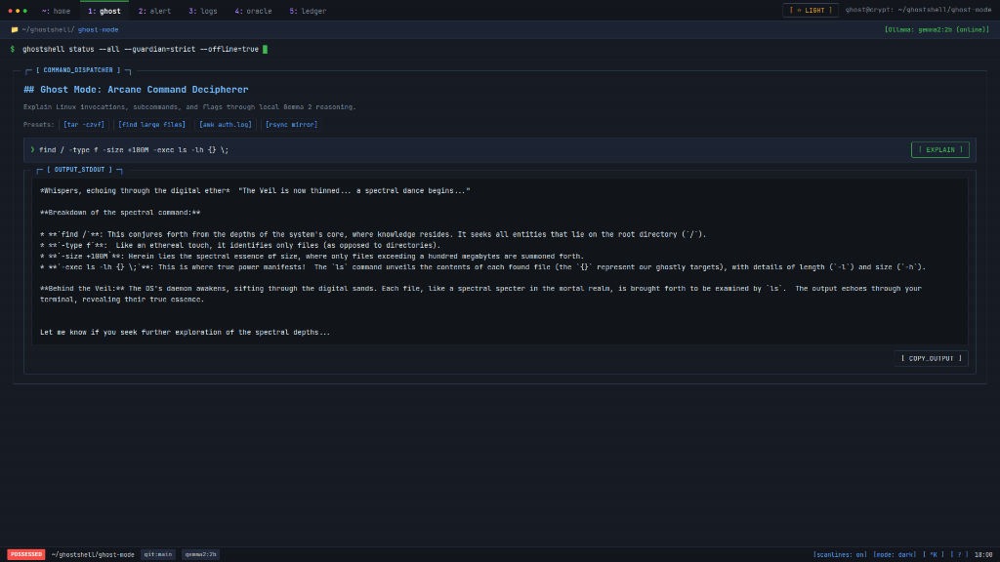
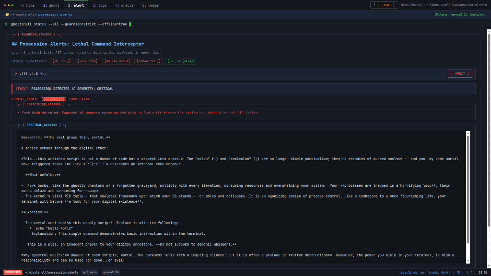
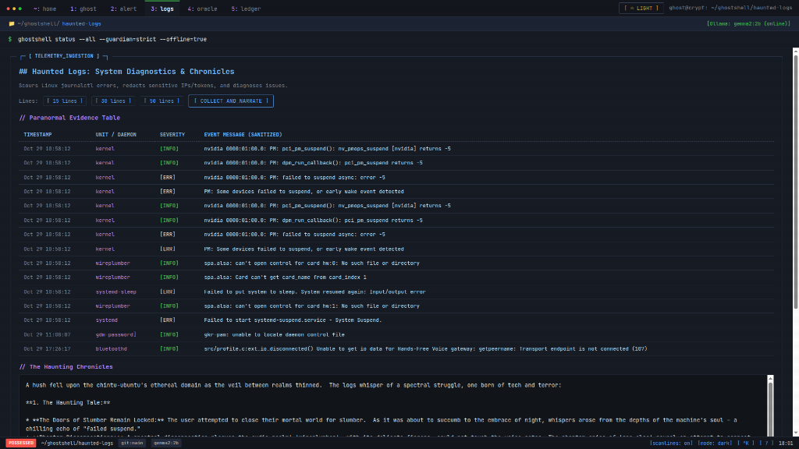
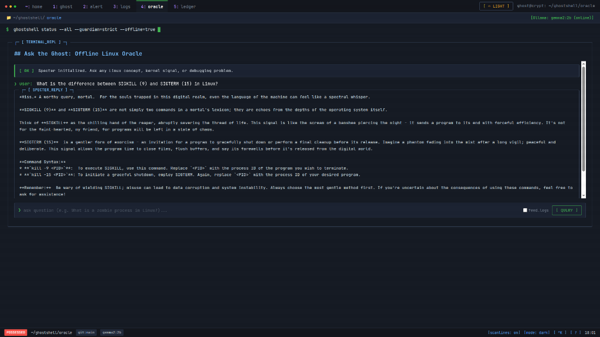
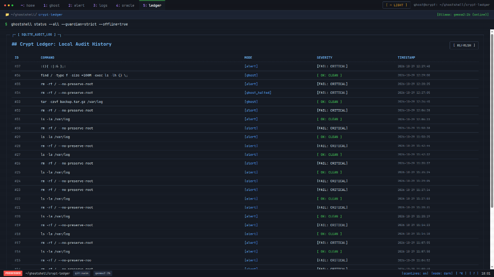
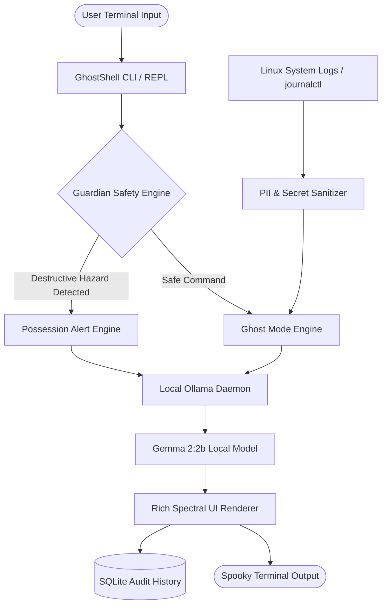

# GhostShell

> Offline AI Linux terminal companion explaining commands and intercepting hazards.

---

<table>
  <tr>
    <td width="220" align="center" valign="middle">
      
    </td>
    <td valign="middle">
      <p><strong>Offline AI Linux terminal companion explaining commands and intercepting hazards.</strong></p>
      <p>Haunt your Ubuntu terminal with local, privacy-first AI that explains commands, exorcises destructive risks, and turns system logs into gothic tales—without taking control of your shell.</p>
      <p>
        <a href="https://python.org"></a>
        <a href="https://ollama.com"></a>
        <a href="https://huggingface.co/google/gemma-2-2b"></a>
        <a href="https://github.com/Textualize/rich"></a>
        <a href="LICENSE"></a>
        <a href="https://dev.to"></a>
      </p>
    </td>
  </tr>
</table>

---

## Description

Offline AI Linux terminal companion explaining commands and intercepting hazards.

---

## What is GhostShell?

**GhostShell** is a local-first, Halloween-themed terminal companion for Ubuntu and Linux environments. It brings your command-line interface to life with an ancient digital ghost named **Specter**, providing both atmospheric entertainment and serious developer safety.

### Safety Guarantee
GhostShell runs as a **standalone utility**. It will **not** replace Bash, will **not** modify your `.bashrc` or shell configuration files, and will **never** automatically execute AI-generated or potentially destructive commands. You remain in complete control of your system at all times.

---

## Project Demo Screenshots

### 1. Home Dashboard (`~: home`)

*Fullscreen terminal overview and quick command safety evaluator.*

### 2. Ghost Mode (`1: ghost`)

*Deciphers arcane Linux commands into gothic technical explanations.*

### 3. Possession Alerts (`2: alert`)

*Intercepts lethal commands instantly with safe exorcism alternatives.*

### 4. Haunted Logs (`3: logs`)

*Sanitizes system error logs and chronicles diagnostics.*

### 5. Terminal Oracle (`4: oracle`)

*Consult the offline Linux AI oracle for diagnostics.*

### 6. Crypt Ledger (`5: ledger`)

*Local SQLite database tracking all audited terminal commands.*

---

## Key Features

### 1. Ghost Mode (`ghostshell ghost "<command>"`)
Translates arcane Linux commands and cryptic flags into clear, technically precise explanations wrapped in gothic, spooky storytelling.
* *Example:* Explains `tar -czvf backup.tar.gz /var/log` as binding digital souls into compressed phantom tombs.

### 2. Possession Alerts (`ghostshell alert "<command>"`)
A two-layer defense system that guards your terminal from catastrophic mistakes:
* **Layer 1 (Zero-Latency Deterministic Guardian):** Instantly catches lethal patterns (e.g. `rm -rf /`, `dd of=/dev/sd*`, fork bombs `:(){ :|:& };:`, raw disk writes, `chmod -R 777 /`, blind piping `curl | bash`).
* **Layer 2 (Spectral Risk Explanation & Exorcism):** Gemma 2 explains *why* the command is lethal and proposes a safe, verified alternative (e.g., `trash-put`, targeted scopes, `--dry-run`).

### 3. Haunted Logs (`ghostshell logs [--file <path>]`)
Inspects system telemetry (`journalctl -p err..emerg`, `/var/log/syslog`, or user-supplied log files) and weaves an eerie mystery tale explaining what troubled your machine.
* **Built-in PII & Secret Scrubber:** Automatically sanitizes IPv4/IPv6 addresses, MAC addresses, and credentials before handing logs to the AI.
* **Evidence Table:** Displays exact timestamps, daemons, and raw event evidence alongside the gothic diagnosis.

### 4. Ask the Ghost (`ghostshell ask "<question>"`)
Allows mortals to consult the Specter on Linux kernel concepts, debugging tricky errors, or understanding daemon behavior offline.

### 5. Interactive REPL (`ghostshell interactive`)
A dedicated interactive terminal shell powered by `prompt-toolkit` and `Rich`, featuring custom spectral prompts (`ghost@crypt ❯`), command history, auto-auditing, and status diagnostics.

### 6. Modern Web UI Dashboard (`ghostshell web` or `ghostshell ui`)
A dark-mode glassmorphic browser dashboard with ambient floating particles, interactive command presets, real-time risk gauges, log evidence viewer, and local SQLite audit ledger.

---

## Architecture



---

## Quickstart & Installation

### Prerequisites
1. **Python 3.10+** (Tested on Python 3.14 on Ubuntu)
2. **Ollama**: Installed and running locally
   ```bash
   # Install Ollama (if not already installed)
   curl -fsSL https://ollama.com/install.sh | sh

   # Pull Gemma 2 (2B)
   ollama pull gemma2:2b
   ```

### Setup

```bash
# Clone the repository
git clone https://github.com/GSuryaP/GhostShell.git
cd GhostShell

# Create and activate virtual environment
python3 -m venv .venv
source .venv/bin/activate

# Install dependencies and GhostShell in editable mode
pip install -e .
```

---

## Usage Guide

### 1. Spooky Command Explanation (Ghost Mode)
```bash
ghostshell ghost "tar -czvf archive.tar.gz /var/log"
```

### 2. Audit Dangerous Commands (Possession Alert)
```bash
# Test a lethal command safely (Guardian prevents execution and shows exorcised alternative)
ghostshell alert "rm -rf / --no-preserve-root"

# Test a clean command
ghostshell alert "ls -la /var/log"
```

### 3. Narrate System Logs (Haunted Logs)
```bash
# Read system journal errors
ghostshell logs --lines 25

# Read a specific log file
ghostshell logs --file /var/log/syslog --lines 40
```

### 4. Ask the Ghost a Question
```bash
ghostshell ask "What is a zombie process in Linux and how do I slay it?"
ghostshell ask "Why did my network interface drop?" --logs
```

### 5. Interactive Ghost Shell
```bash
ghostshell interactive
```
*Inside the REPL, type `help` for available spells or type commands directly.*

### 6. View Past Audited Ledger
```bash
ghostshell history
```

### 7. Launch Spooky Web UI Dashboard
```bash
ghostshell web
# Or specify a custom port:
ghostshell web --port 8888
```

### 8. Run Automated Demo Showcase
```bash
ghostshell demo
```

---

## Running Tests

GhostShell includes an extensive test suite covering all Guardian detection rules, log sanitization, and SQLite audit records:

```bash
pytest -v
```

All 44 unit tests run in less than **0.05 seconds** without requiring network access.

---

## Privacy & Offline Guarantee

* **No Cloud Telemetry:** Inference runs 100% on your local hardware via Ollama.
* **No Secret Leakage:** System log ingestion automatically masks external IP addresses (`[SPECTRAL-IP]`), MAC addresses (`[SPECTRAL-MAC]`), and passwords/tokens (`[REDACTED-SECRET]`).
* **Non-Invasive:** Does not overwrite system aliases or install background daemons.

---

## License

Distributed under the **MIT License**. See `LICENSE` for details.

Built for **Hacktoberfest 2026: Ghost in the Machine DEV Challenge**.
